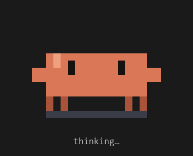

# os-deck

**English** · [Português](README.pt-BR.md)

**713 automated tests** (686 written for os-deck) · **[a changelog for every release](CHANGELOG.md)** · [what's original here](#what-os-deck-adds-over-flightdeck)



A side dock that shows, live, what your Claude Code session is doing: the plan broken into tasks by phase, each task's subagents, architect consults, permission checks, git and GitHub state, the Jira epic and the session log. Its colours follow the active skin of the [skins](https://github.com/hellosverre/claude-skins) mod when that mod is on.

It is a fork of [Flightdeck](https://github.com/scasella/claude-flightdeck) (MIT, by Stephen Casella), adapted to our workflow. The original documentation is in [docs/flightdeck-original.md](docs/flightdeck-original.md).

## What os-deck adds over Flightdeck

os-deck forked [Flightdeck](https://github.com/scasella/claude-flightdeck) at 0.4.0, which provides the base dock: main vitals, architect timeline, permission gate, agent cards and session log. Everything below was built for os-deck and is not in Flightdeck.

| Addition | What it does |
|---|---|
| **[Agent Proof](#agent-proof)** | Runs the checks you allowed and marks a task verified only on the exact content they passed on |
| **[Mascot](#the-mascot)** | An animated pixel Clawd with 11 states that follow the session, and a cube for each real subagent |
| **[cswap](#claude-account-cswap)** | The active Claude account and its limits, switched from the dock |
| **GitHub** | The branch's PR with its checks, review and the issues it closes |
| **[Alerts](#alerts-and-forecasts)** | A notification when an ask is left waiting or a long turn ends |
| **[Forecasts](#alerts-and-forecasts)** | Turns left before the context fills, time left for the plan |
| **History** | Turns, time, tasks, subagents, cost and wait per day, across sessions (`/os-deck today`, `/os-deck history`) |
| **Plan, git and Jira** | Tasks as a tree by phase with their subagents, the state of each repository, the Jira epic |
| **Tests** | 686 new tests, on top of 27 kept from Flightdeck's 28 |

## Author

Caio Cerano ([@CaioCerano](https://github.com/CaioCerano)).

## Install

At the Claude Code prompt (terminal):

```text
/plugin install os-deck --marketplace CaioCerano/os-deck
```

From a shell:

```text
claude plugin install os-deck --marketplace CaioCerano/os-deck
```

In the desktop app, where `/plugin` does not run: click + next to the prompt box, then Plugins, Add marketplace with `CaioCerano/os-deck`, then Add plugin.

Answer `y` to add the marketplace and choose the user scope. It takes effect from the next session (or after `/reload-plugins`). If you use the original Flightdeck, disable it (`claude plugin disable flightdeck@claude-flightdeck`): both answer to `/flightdeck`.

## What it is for

Following long sessions without scrolling the transcript. In the `plan` view (the default):

| Section | What it shows |
|---|---|
| Header | The mascot (Clawd) and, beside it, model, context, cost, the 5h/7d limits and the active `cswap` account |
| Git | Branch, ahead/behind, and staged and conflicted files of the session's repository; in a folder holding several, only each one's branch. `gitChildRepos` adds untracked files and the full row for each |
| GitHub | The branch's PR (state, checks, review, issues it closes) through `gh`; with no PR, the repository's open ones |
| Epic | The Jira issue cited in the session and the children of the epic above it |
| Plan | The tasks (`TaskCreate`) grouped by work and phase (Plano, Implementação, Qualidade), with the subagents nested under each task |
| Architect | Each consult with the architect subagent: when, what about, and the advice |
| Agents | Subagents by type, with model and typical time |
| Timeline | Tasks and agents side by side |
| Log | The session's events |

With the `always` plan policy, the mod asks Claude to break any multi-step work into tasks by phase, so the dock always has a plan. The phase names are the `planPhases` option.

The dock opens beside the conversation in a full-screen terminal from 110 columns; in smaller terminals it shows above the prompt, summarised.

## Commands

`/os-deck` (or `/flightdeck`):

| Command | What it does |
|---|---|
| `/os-deck` | Opens the dock |
| `/os-deck close` | Closes the dock |
| `/os-deck reset` | Clears what the dock gathered this session |
| `/os-deck demo` | Shows a sample plan in place of yours; `/os-deck reset` brings yours back |
| `/os-deck hide <section>` / `show <section>` | Hides or shows a section (kept between sessions), `pet` included |
| `/os-deck proof` | Says what Agent Proof allows and has seen this session |
| `/os-deck proof setup [folder]` | Shows the checks found, to allow in the dock |
| `/os-deck proof check <test\|typecheck\|lint\|build> [--dir <folder>] -- <command>` | Drafts a check you name |
| `/os-deck proof history` | Lists the saved runs, claims and reviews, which are never evidence |
| `/os-deck sections` | Lists the sections and which are hidden |
| `/os-deck layout <auto\|compact\|wide\|mini>` | Changes the layout |
| `/os-deck epic` | Reads the anchored issue's epic from Jira |
| `/os-deck github` | Reads GitHub now and reports the branch's PR (or why it could not read) |
| `/os-deck today` / `history` | Today's summary, or the last 7 days with a total: turns, time, tasks, subagents, cost, permission asks |
| `/os-deck pet` | Says whether the mascot is shown and, if not, why (dock size, hidden section, option) |
| `/os-deck account` (or `conta`) | Lists the `cswap` accounts, with each one's 5h/7d usage |
| `/os-deck account <n\|email\|alias>` | Switches the Claude account through `cswap` |
| `/os-deck account next` | Moves to the next account, like `cswap switch` with no target |

In the dock, the header's `account` row is a button (shortcut `a`): it opens the list of the accounts you already have in `cswap`, with each one's 5h/7d usage. Clicking an account switches to it and shows the result in a toast.

## Agent Proof

An agent's claim of completion is not proof of completion. Agent Proof runs checks you allowed, by itself, and ties what it saw to the exact content of the repository.

1. Type `/os-deck proof setup`. The dock shows the commands it found and the scripts behind them. Nothing has run.
2. Press **allow** (automatic: checks run when a turn ends with an answer and no agent is at work) or **manual only**. Either lasts for this session.
3. For tests, press **accept as baseline** after the first run: from then on at least that many must pass and no more may be skipped.
4. A completed task gets a mark. Open it to see what was claimed, what os-deck verified and what is left for you, and mark it reviewed.

| State | Meaning |
|---|---|
| Pending | Claimed, and no checks have run on this content yet |
| Verifying | The checks are running |
| Verified (`✓ checks`) | Every required check passed on the content as last read, and that content changed during this task, with no other task or agent seen editing |
| Failed | A check failed |
| Inconclusive | Something needed is missing or unclear: no baseline, unreadable content, tasks that overlapped, an edit outside the allowed repositories |
| Stale | The content changed after the checks ran |

Verified is about the checks. Whether the task meets its acceptance criteria is the separate review, which only you can mark.

What it trusts:

- Never an agent's message, tool output or "tests pass", and never the saved history, which is only history.
- Only a press in the dock allows or runs on demand. A command only shows or drafts: a clicked link arrives looking like a typed command, so read a draft before you allow it.
- A change to a watched file pauses the checks until you are shown them again and allow them: the scripts shown, the files they name to run, their manifests and config, programs of the same names, whatever their extension, in each `node_modules/.bin` up to the drive's root, and the `package.json` of each folder above.
- `/clear` and a new session drop every allowance and all evidence.

What to know before you press allow:

- **The checks run as you, outside permission prompts and the sandbox.** With automatic runs, code an agent writes into your tests runs at the end of the turn without a prompt. Known credential variables are blanked; the rest of your environment is not.
- It does not see ignored files, empty folders, alternate data streams, executable bits changed only on disk, dependencies, or shell and MCP writes outside the allowed repositories. An agent that edits your tests can make them pass: changed files that look like tests, scripts or test config by their name are listed for your review, and others can matter as much.
- Edits are attributed by the file tools alone: who made a shell or MCP write is not known. A task another agent edited during, other than a subagent filed under it, is Inconclusive; so is a task a subagent completes after the main agent edited in it.
- Files changed and changed back while a check runs are not seen.
- In a very large repository the dock keeps whole file listings in session state, several MB of it.
- Allowing needs the plan view and a dock at least 40 columns wide.
- Processes a check leaves in the background may outlive it.
- Only a small grammar runs automatically: `claude plugin test`, `bun test`, `bash <file>`, `node <file.js>`, a few tools (`tsc`, `eslint`, `prettier --check`, `jest`, `vitest run`, `vite build`, `pytest`, `ruff check`, `mypy`) with known flags, and `npm run <script>` where the script is plain words joined by `&&` of those. An unknown program such as `cargo` or `make` is manual only. Anything else is refused: quotes, globs, variables, redirects, `npx`, `pnpm`, `yarn`, `turbo`, and `.npmrc` settings not known to be harmless. Setup leaves out what it cannot allow and says so.
- Test counts are read from `bun test`, `claude plugin test` and `bash …/run_all.sh` printing `[PASS]`/`[FAIL]` lines. Other test runners cannot verify, so setup does not propose them. Typecheck, lint and build go by exit code.
- On Windows, an npm check is refused where a program it runs is a link in `node_modules/.bin`: setup follows no link there, as one could lead to a network share.
- An npm check is refused under a workspace of a folder above, which would lend it config nobody was shown.
- An npm check is refused where a folder's name holds the character that separates PATH entries (`;` on Windows), which would send npm into another folder.
- An edit counts as inside a repository only where the tool named it by a full path. A relative one, or one with no drive or with `~`, counts as outside: which folder it was resolved from is not known.
- An edit still running, or waiting on your permission, as a task completes counts as that task's, even if it is denied afterwards.
- A check that has started when you begin another turn is left to finish; none is started after that.
- A claim you never reviewed, even one replaced or reopened since, keeps its repository at "to review" for the session (its last 1,000 claims). Only its newest claim has a button.
- A review covers only the repositories it listed.
- It does not watch imports, dependencies, tool config, what shell scripts call, or npm config in your home folder and environment: a change there runs unseen.
- A check that rewrites a file it is watched by, such as running what it just built, cannot verify.
- A change with no tool call behind it, by an editor or another session, can take up to 30 seconds to turn a check stale.
- After 1,000 claims in a session, checks stop running by themselves: press verify.
- A repository that cannot be read for certain (links, submodules, nested repositories, conflicts, over 20,000 files) is never verified.
- Once a repository is allowed, a task's start and completion wait up to 1.5 seconds while its content is read.
- Every path a check names or reads must have the disk's exact capitals, or setup refuses: a Windows folder can be case-sensitive.
- **Windows only**, and tested on Windows 11 only. Elsewhere `/os-deck proof` refuses and nothing can be allowed; the rest of os-deck is unaffected.

The design and its threat model are in [the proposal](docs/proposals/agent-proof.md).

## The mascot

The `plan` view's header starts with **Clawd**, a pixel-art mascot drawn for this mod (24 columns × 8 rows). It is made of half blocks (`▀`) with a foreground and a background colour, so it works in any terminal, with no image. Beside it, the session summary is leaner: the context gauge is shorter, the limits show without gauges, and the request count goes.

| State | When |
|---|---|
| Waiting | session open, nothing running (blinks and glances around) |
| Thinking | the turn started and the model is answering |
| Reading | `Read`, `Grep`, `Glob`, `WebFetch`… in the main loop (an open book held in front, eyes running across the pages, a page turns) |
| Editing | `Edit`, `Write`… in the main loop (typing on a keyboard in front of it, keys light up and the text grows above its head) |
| Running a command | `Bash` or `PowerShell` in the main loop (a small terminal with `>_`: prompt, command, output) |
| With subagents | a small floating cube with eyes for each subagent, in its colour (the same as the `■` on its plan row): big up to 4, mini up to 11, then `+N`. A finished one stays a moment with a `✦`; a failed one turns red |
| Compacted | the context was compacted (squashes flat under a `⟲` and springs back, for 2.5 s) |
| Asking permission | a tool waits for your yes (a sign with "!") |
| Error | a main-loop tool failed (for 3 s) |
| Done | the turn ended with an answer (hops, for 5 s) |
| Sleeping | 5 min with nothing happening |

With context at 85% or more, the mascot sweats (a drop beside its head) and the caption gets `· ctx 92%`. The `▾` next to the caption (shortcut `p`) opens the detail: the main loop's tool with its elapsed time, and the subagents, each a button that opens its card.

Each state starts from its first frame. Between two kinds of work (thinking, reading, editing, running, subagents), the state shown stays at least 0.7 s, so quick tool calls do not make the pet flicker; permission, error, compaction, done and rest cut in at once.

The body wears the active skin's accent colour, in the `native` style too; with no skin, Claude's orange. The animation runs in a surface module (`hooks/pet.tsx`) and only redraws the pet's region when the frame changes, never the whole dock.

The pet sits beside the summary from 58 columns and on top of it in narrower docks. In a dock under 30 rows it is left out so it does not take room from the plan: in its place, the header shows a quiet line with the current size and what is needed (`pet hidden: pane 70×20, needs 24×30`), and `/os-deck pet` explains why it is or is not shown. It is also not drawn in the `mini` layout or the `classic` view. To hide it, use `/os-deck hide pet` (or `mascote`); to turn it off for good, the `pet: false` option.

## Alerts and forecasts

With the `alerts` option (on by default), OS-Deck sends a native notification through the channel you set up in Claude Code (iTerm2, kitty, Ghostty, the terminal bell or the app) when:

- a permission ask has waited on you for `alertAfterS` seconds (30 by default); not in auto mode, where the classifier answers;
- a turn of `alertTurnMin` minutes or more (2 by default) ends; not when you stopped it yourself.

With no notification channel, the alert becomes a toast in the dock.

The header's context line shows how many turns are left before the context fills (`~6 turns left`, or `~6t` beside the mascot), from the average growth of the last six turns; a compaction starts the count over. In the plan, the bar shows the time left (`~12m`), from the average duration of the tasks finished this session; with none finished yet, there is no estimate.

## Claude account (cswap)

With [claude-swap](https://github.com/realiti4/claude-swap) (`cswap`) installed, the header shows the active account (`account you@company.com #2`) and follows switches made outside OS-Deck: from the terminal, the menu bar or `cswap auto`. The mod reads `cswap list --json` when the session opens, every 45 s, and before each prompt and measurement (at most once every 5 s). Without `cswap`, the row does not show and nothing else changes.

Why this is needed: the session's 5h/7d limits come from API responses and only change when a new response arrives. Also, on macOS `cswap` writes the credential to the Keychain, and Claude Code keeps the old token cached for about 30 s. So right after a switch, the session may still answer through the previous account. To avoid showing the wrong account's limits:

- when the active account changes, the log records `account a → b` and the session's limits are dropped;
- for 35 s, the session's measurements are ignored, and the account shows in amber with `switching…`;
- while the session has no limits of its own, the limits row shows `cswap`'s for the active account, marked with `~` (`~5h`). This is `cswap`'s cached reading, not a live value. Outside that window, the session's limits always win.

A switch made outside OS-Deck is only seen at the next read: within 45 s, or sooner, at the next prompt. If the new account's limits arrive in that interval, they are also dropped when the switch is detected, and the `~` shows for 35 s. This is an accepted inaccuracy.

On Linux and Windows `cswap` writes to a file, and Claude Code usually applies the switch from the next message. The 35 s window applies on all three systems, as a precaution.

The switch runs `cswap switch <target> --json` by argument vector, with no shell. The target must be a number of up to 3 digits, an email or an alias (`[a-z0-9][\w.-]{0,31}`), and may never start with `-`. `cswap` does not accept `--` before the target, so this validation is the protection. `next` (or `próxima`) is a reserved word: an alias with that name can only be used by its number or email.

## Capabilities used

From `claude plugin validate mods/os-deck`:

- Events: `session.start`, `session.end`, `session.measure`, `session.compact`, `turn.start`, `turn.step`, `turn.complete`, `agent.offer`, `agent.spawn`, `tool.check`, `tool.run`, `command.run`, `classic.UserPromptSubmit`, `classic.PermissionRequest` and `classic.PostToolUse` (only to read the permission mode), `ui.render` of the `Pane`.
- **Sensitive:**
  - `prompt.submit`: only reads the prompt to find a cited Jira issue key (which anchors the plan). It does not change the prompt.
  - `prompt.compose`: adds a section to the system prompt asking for tasks grouped by work and phase (turned off with `planHint` and `planPolicy`).
  - `tool.call` and `session.append`: only watch tool calls and messages to draw the plan, the agents, the permissions and the log. They pass everything on without denying or rewriting anything. Nothing waits on them, except a task's start and completion once Agent Proof has a repository allowed (up to 1.5 seconds).
  - `$.process.run`: runs `git --no-optional-locks -C <dir> symbolic-ref|diff-index --cached|ls-files|for-each-ref|rev-list|rev-parse` by argument vector, with no shell, for the Git section. With the `github` option on, it runs `<ghCommand> pr view --json …` and `<ghCommand> pr list --state open --json …` in the session's directory (read only). With the `cswap` option on, it also runs `<cswapCommand> list --json` (reading the account) and `<cswapCommand> switch [<target>] --json`, the latter only when you ask with `/os-deck account <target>`. The target is validated first (see the section above), and the executables come only from `userConfig`, never from a command argument.
  - `$.process.spawn`: runs Agent Proof's checks, only those you allowed with a press in this session, by argument vector.
  - In a repository allowed for Agent Proof, `$.process.run` also runs `git ls-files --others`, `git config --show-scope --get-all core.excludesFile` and `git hash-object --no-filters --stdin-paths`, which read your files' contents without running filters.
  - For Agent Proof, `$.fs.read` also reads a repository's manifests, its npm and bun config and the files its checks name, when you type setup and, once allowed, after tool calls and every 30 seconds (`$.clock.every`). `$.fs.stat` resolves the links of edited paths.
  - `$.fs.list`, `$.fs.stat`, `$.fs.read`: find the repositories beneath an opened folder (among its first 200 folders) and read each one's branch from `.git/HEAD`, without following links and without running git there (unless `gitChildRepos` is on).
  - `$.tool.call`: reads the Jira issue and epic through the Atlassian connector (`getJiraIssue`, `searchJiraIssuesUsingJql`), only with `jiraFetch` on or with `/os-deck epic`. Each read asks permission like any tool call.
- `$.session.cwd`, `$.session.id`, `$.session.messages`, `$.session.usage`: the session's directory, id, history (to rebuild the plan when resuming) and usage.
- `$.state` (`os-deck.*`): the dock's state in the session, including the main loop's tool and the turn-end and failure times the mascot uses, and the last account reading (`os-deck.account`), so a reload of the mod does not count as a switch. It also reads, without writing, `skins.prefs`, `skins.custom` and `skins.isLight`, to use the skin's colours.
- `$.agent.list`: whether an agent is still at work, before Agent Proof runs by itself.
- `$.store`: Agent Proof's history and the checks last allowed (a suggestion, never a permission); hidden sections; the plan's history under a key for each session (`plan-history:<directory hash>#<session>`, two weeks); each day's summary (`os-deck:day:<day>#<session>`, folded into `os-deck:history-days` once the day is past, about two months).
- `$.ui.notify`: the alerts for a waiting ask and a long turn (the `alerts` option). `$.clock.now`, `$.clock.every` (reading the account every 45 s), `$.clock.after` (a new reading when the 35 s window ends, and the ask alerts), all cancelled when the session ends, except that Agent Proof's 30-second watch goes on through `/clear` and a resume, `$.command.register`, `$.ui.open`, `$.ui.close`, `$.ui.resolve`, `$.ui.status`, `$.ui.toast`.

Text the dock stores from commands, agents, tasks, Jira, GitHub and errors has control characters stripped and goes through a redaction that hides tokens, passwords and keys. It works by pattern, so a secret in a format it does not know can still show. Outside a repository allowed for Agent Proof, git is read only with commands that do not open your files' contents, because those can make git run programs a repository chooses: so the Git section counts staged and conflicted files, not modified ones, and untracked ones only with `gitChildRepos` (listing them makes git open nested repositories), and never says a repository is clean. Folders laid out as bare repositories are not read (this needs git 2.38 or later). Jira titles and types, and the section names of a plan you approved, do not enter the system prompt. On Windows, Claude Code's own git follows network paths named in the config of the repository you open, which can send your login hash to that host. The dock cannot prevent that, so open only repositories you trust.

## Configuration

```text
/plugin configure os-deck@os-mods
```

The main ones: `view` (`plan` or `classic`), `layout`, `panels` (which sections and in what order), `palette` (`skin`, `theme`, `pastel`), `background` (a hex background colour, to match your terminal), `planPolicy` and `planPhases`, `architectPattern` (which agents count as the architect), `jiraSite` and `jiraFetch`, `openOnStart`, `statusLine`, `pet` (the mascot in the header, on by default), `cswap` (turns on the account row and `/os-deck account`, on by default), `cswapCommand` (the `cswap` executable, when Claude Code cannot find it on the `PATH`), `github` and `ghCommand` (the GitHub section), `alerts`, `alertAfterS` and `alertTurnMin` (the alerts). Each one is described in `plugin.json`.

## System dependencies

`git` on the `PATH`, only for the Git section (without it, the section stays empty). The [GitHub CLI](https://cli.github.com) (`gh`, signed in) is optional, only for the GitHub section: without it, the section does not show and `/os-deck github` says why. The Atlassian connector is optional, only for the Jira epic. [claude-swap](https://github.com/realiti4/claude-swap) (`cswap`) is optional too, only for the account row and `/os-deck account`. The mod does not install it: without it, the row does not show.

## Uninstall

```text
claude plugin uninstall os-deck@os-mods
```

## Claude Code versions validated

2.1.301 on macOS (Darwin 25.3). The `cswap` account was validated on 2.1.302 on macOS, with claude-swap and two accounts. Version 0.5.1 passed its 713 tests on the 2.1.330 test kit on Windows 11, which runs the dock and the surface module in a simulated terminal; it has not yet been seen in an interactive session. Ubuntu is not validated; the mod does not depend on the system beyond `git` and, optionally, `gh` and `cswap`.

## License

MIT, inherited from Flightdeck. See [LICENSE](LICENSE).
