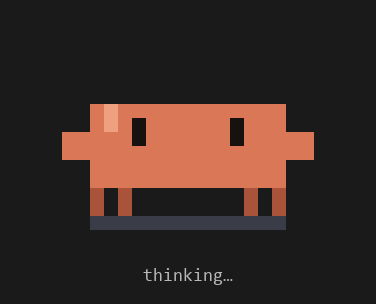

# os-deck

[English](README.md) · **Português**

**722 testes automatizados** (695 escritos para o os-deck) · **[changelog de cada versão](CHANGELOG.pt-BR.md)** · [o que é original aqui](#o-que-o-os-deck-acrescenta-ao-flightdeck)



Painel lateral (dock) que mostra, ao vivo, o que a sessão do Claude Code está fazendo: o plano quebrado em tarefas por fase, os subagentes de cada tarefa, as consultas ao arquiteto, as checagens de permissão, o estado do git, o épico do Jira e o log da sessão. As cores seguem o skin ativo do mod [skins](https://github.com/hellosverre/claude-skins), quando ele está ligado.

É um fork do [Flightdeck](https://github.com/scasella/claude-flightdeck) (MIT, de Stephen Casella), adaptado para o nosso fluxo. A documentação original está em [docs/flightdeck-original.md](docs/flightdeck-original.md).

## O que o os-deck acrescenta ao Flightdeck

O os-deck saiu do [Flightdeck](https://github.com/scasella/claude-flightdeck) 0.4.0, que fornece a base do dock: sinais vitais, linha do tempo do architect, gate de permissões, cartões de agentes e log da sessão. Tudo abaixo foi feito para o os-deck e não existe no Flightdeck.

| Adição | O que faz |
|---|---|
| **[Agent Proof](#agent-proof)** | Roda os checks que você liberou e só marca uma tarefa como verificada no conteúdo exato em que passaram |
| **[Mascote](#o-mascote)** | Um Clawd animado em pixel art com 11 estados que seguem a sessão, e um cubo para cada subagente de verdade |
| **[cswap](#conta-do-claude-cswap)** | A conta do Claude ativa e os limites dela, trocada pelo próprio dock |
| **GitHub** | O PR da branch com checks, review e as issues que ele fecha |
| **[Alertas](#alertas-e-previsões)** | Uma notificação quando um pedido fica esperando ou um turno longo termina |
| **[Previsões](#alertas-e-previsões)** | Turnos até o contexto encher, tempo restante do plano |
| **Histórico** | Turnos, tempo, tarefas, subagentes, custo e espera por dia, entre sessões (`/os-deck today`, `/os-deck history`) |
| **Plano, git e Jira** | Tarefas em árvore por fase com seus subagentes, o estado de cada repositório, o épico do Jira |
| **Testes** | 695 testes novos, além de 27 mantidos dos 28 do Flightdeck |

## Autor

Caio Cerano ([@CaioCerano](https://github.com/CaioCerano)).

## Instalar

No prompt do Claude Code (terminal):

```text
/plugin install os-deck --marketplace CaioCerano/os-deck
```

De um shell:

```text
claude plugin install os-deck --marketplace CaioCerano/os-deck
```

No app desktop, onde `/plugin` não roda: clique no + ao lado da caixa do prompt, depois Plugins, Add marketplace com `CaioCerano/os-deck`, depois Add plugin.

Responda `y` para adicionar o marketplace e escolha o escopo de usuário. Vale a partir da próxima sessão (ou depois de `/reload-plugins`). Se você usa o Flightdeck original, desative-o (`claude plugin disable flightdeck@claude-flightdeck`): os dois respondem a `/flightdeck`.

## Para que serve

Acompanhar sessões longas sem rolar o transcript. Na visão `plan` (padrão):

| Seção | O que mostra |
|---|---|
| Cabeçalho | O mascote (Clawd) e, ao lado, modelo, contexto, custo, limites 5h/7d e a conta ativa do `cswap` |
| Git | Branch, ahead/behind e arquivos staged e em conflito do repositório da sessão; numa pasta com vários, só a branch de cada um. `gitChildRepos` acrescenta os não rastreados e a linha completa de cada um |
| GitHub | O PR da branch (estado, checks, review, issues que fecha) pelo `gh`; sem PR, os abertos do repositório |
| Épico | A issue do Jira citada na sessão e os filhos do épico acima dela |
| Plano | As tarefas (`TaskCreate`) agrupadas por trabalho e fase (Plano, Implementação, Qualidade), com os subagentes aninhados em cada tarefa |
| Arquiteto | Cada consulta ao subagente arquiteto: o momento, o assunto e a recomendação |
| Agentes | Subagentes por tipo, com modelo e tempo típico |
| Linha do tempo | Tarefas e agentes lado a lado |
| Log | Os eventos da sessão |

Com a política de plano `always`, o mod pede ao Claude que quebre todo trabalho de vários passos em tarefas por fase, para o painel sempre ter um plano.

O painel abre ao lado da conversa no terminal em tela cheia a partir de 110 colunas; em terminais menores aparece acima do prompt, resumido.

## Comandos

`/os-deck` (ou `/flightdeck`):

| Comando | O que faz |
|---|---|
| `/os-deck` | Abre o painel |
| `/os-deck close` | Fecha o painel |
| `/os-deck reset` | Zera o que o painel acumulou na sessão |
| `/os-deck demo` | Mostra um plano de exemplo no lugar do seu; `/os-deck reset` traz o seu de volta |
| `/os-deck hide <seção>` / `show <seção>` | Esconde ou mostra uma seção (guardado entre sessões), `pet` incluído |
| `/os-deck proof` | Diz o que o Agent Proof liberou e viu nesta sessão |
| `/os-deck proof setup [pasta]` | Mostra os checks encontrados, para liberar no dock |
| `/os-deck proof check <test\|typecheck\|lint\|build> [--dir <pasta>] -- <comando>` | Rascunha um check que você indica |
| `/os-deck proof history` | Lista as execuções, alegações e revisões salvas, que nunca são evidência |
| `/os-deck sections` | Lista as seções e quais estão ocultas |
| `/os-deck layout <auto\|compact\|wide\|mini>` | Troca o layout |
| `/os-deck epic` | Lê do Jira o épico da issue ancorada |
| `/os-deck github` | Lê o GitHub agora e diz o PR da branch (ou por que não leu) |
| `/os-deck today` / `history` | O resumo de hoje, ou dos últimos 7 dias com total: turnos, tempo, tasks, subagentes, custo, pedidos de permissão |
| `/os-deck pet` | Diz se o mascote está aparecendo e, se não, por quê (tamanho do painel, seção oculta, opção) |
| `/os-deck account` (ou `conta`) | Lista as contas do `cswap`, com o uso de 5h/7d de cada uma |
| `/os-deck account <n\|email\|alias>` | Troca a conta do Claude pelo `cswap` |
| `/os-deck account next` | Passa para a próxima conta, como `cswap switch` sem alvo |

No painel, a linha `account` do cabeçalho é um botão (atalho `a`): ela abre a lista das contas que você já tem no `cswap`, com o uso de 5h/7d de cada uma. Clicar numa conta faz a troca e mostra o resultado num aviso.

## Agent Proof

Um agente dizer que terminou não prova que terminou. O Agent Proof roda, por conta própria, os checks que você liberou e amarra o que viu ao conteúdo exato do repositório.

1. Digite `/os-deck proof setup`. O dock mostra os comandos que achou e os scripts por trás deles. Nada rodou ainda.
2. Aperte **allow** (automático: os checks rodam quando um turno termina com resposta e nenhum agente está trabalhando) ou **manual only**. Os dois valem só nesta sessão.
3. Para testes, aperte **accept as baseline** depois da primeira execução: dali em diante pelo menos esse número precisa passar e não mais que aquele pode ser pulado.
4. Uma tarefa concluída ganha uma marca. Abra para ver o que foi alegado, o que o os-deck verificou e o que fica com você, e marque como revisada.

| Estado | Significado |
|---|---|
| Pending | Alegada, e nenhum check rodou nesse conteúdo ainda |
| Verifying | Os checks estão rodando |
| Verified (`✓ checks`) | Todo check obrigatório passou no conteúdo como lido por último, e esse conteúdo mudou durante esta tarefa, sem outra tarefa ou agente visto editando |
| Failed | Um check falhou |
| Inconclusive | Falta algo ou algo não está claro: sem baseline, conteúdo ilegível, tarefas sobrepostas, edição fora dos repositórios liberados |
| Stale | O conteúdo mudou depois que os checks rodaram |

Verified fala dos checks. Se a tarefa atende aos critérios de aceite é a revisão, separada, que só você marca.

No que ele confia:

- Nunca na mensagem de um agente, na saída de uma ferramenta ou em "os testes passam", e nunca no histórico salvo, que é só histórico.
- Só um botão apertado no dock libera ou roda sob demanda. Um comando só mostra ou rascunha: um link clicado chega igual a um comando digitado, então leia o rascunho antes de liberar.
- Um arquivo vigiado que muda pausa os checks até você ver de novo e liberar: os scripts mostrados, os arquivos que eles mandam rodar, os manifestos e configs deles, programas de mesmo nome, com qualquer extensão, em cada `node_modules/.bin` até a raiz do disco, e o `package.json` de cada pasta acima.
- `/clear` e uma sessão nova derrubam toda liberação e toda evidência.

O que saber antes de apertar allow:

- **Os checks rodam como você, fora dos pedidos de permissão e do sandbox.** No automático, código que um agente escreve nos seus testes roda no fim do turno sem perguntar. Variáveis de credencial conhecidas são apagadas; o resto do seu ambiente, não.
- Ele não vê arquivos ignorados, pastas vazias, alternate data streams, bits de execução mudados só no disco, dependências nem escritas de shell e MCP fora dos repositórios liberados. Um agente que edita seus testes pode fazê-los passar: arquivos alterados que pelo nome parecem testes, scripts ou config de teste são listados para a sua revisão, e outros podem importar tanto quanto.
- Edições são atribuídas só pelas ferramentas de arquivo: não se sabe quem fez uma escrita de shell ou MCP. Uma tarefa durante a qual outro agente editou, que não um subagente dela, fica Inconclusive; assim como uma que um subagente conclui depois de o agente principal ter editado nela.
- Arquivos alterados e desfeitos enquanto um check roda não são vistos.
- Num repositório muito grande o dock guarda listagens inteiras de arquivos no estado da sessão, alguns MB.
- Liberar exige a view plan e um dock de pelo menos 40 colunas.
- Processos que um check deixa em segundo plano podem continuar depois dele.
- Só uma gramática pequena roda no automático: `claude plugin test`, `bun test`, `bash <arquivo>`, `node <arquivo.js>`, algumas ferramentas (`tsc`, `eslint`, `prettier --check`, `jest`, `vitest run`, `vite build`, `pytest`, `ruff check`, `mypy`) com flags conhecidas, e `npm run <script>` quando o script é feito de palavras simples ligadas por `&&` dessas. Um programa desconhecido como `cargo` ou `make` é só manual. O resto é recusado: aspas, globs, variáveis, redirecionamentos, `npx`, `pnpm`, `yarn`, `turbo` e configurações de `.npmrc` que não se sabe serem inofensivas. O setup deixa de fora o que não pode liberar e avisa.
- A contagem de testes é lida do `bun test`, do `claude plugin test` e de `bash …/run_all.sh` que imprime linhas `[PASS]`/`[FAIL]`. Outros runners não podem verificar, então o setup não os propõe. Typecheck, lint e build valem pelo código de saída.
- No Windows, um check de npm é recusado quando um programa que ele roda é um link em `node_modules/.bin`: o setup não segue link ali, porque um poderia levar a um compartilhamento de rede.
- Um check de npm é recusado sob um workspace de uma pasta acima, que emprestaria a ele uma config que ninguém viu.
- Um check de npm é recusado quando o nome de uma pasta tem o caractere que separa as entradas do PATH (`;` no Windows), que mandaria o npm para outra pasta.
- Uma edição só conta como dentro de um repositório quando a ferramenta a nomeou com caminho completo. Uma relativa, sem drive ou com `~` conta como fora: não se sabe de qual pasta ela foi resolvida.
- Uma edição é localizada quando começa a rodar e de novo quando termina, e a que rodou conta mesmo se falhou. Um processo que move pastas ou links durante a própria escrita ainda pode esconder onde ela caiu.
- Uma edição ainda rodando, ou esperando a sua permissão, quando uma tarefa termina conta como dessa tarefa, mesmo se for negada depois.
- Um check que já começou quando você inicia outro turno termina; nenhum começa depois disso.
- Uma alegação que você nunca revisou, mesmo substituída ou reaberta depois, mantém o repositório dela em "to review" pela sessão (as últimas 1.000 alegações). Só a mais nova tem botão.
- Uma revisão cobre só os repositórios que ela listou.
- Ele não vigia imports, dependências, config de ferramentas, o que scripts de shell chamam, nem config do npm na sua pasta pessoal e no ambiente: uma mudança ali roda sem ser vista.
- Um check que reescreve um arquivo pelo qual é vigiado, como rodar o que acabou de compilar, não pode verificar.
- Uma mudança sem chamada de ferramenta, de um editor ou outra sessão, pode levar até 30 segundos para deixar um check stale.
- Depois de 1.000 alegações numa sessão, os checks param de rodar sozinhos: aperte verify.
- Um repositório que não dá para ler com certeza (links, submódulos, repositórios aninhados, conflitos, mais de 20.000 arquivos) nunca é verificado.
- Com um repositório liberado, o início e a conclusão de uma tarefa esperam até 1,5 segundo enquanto o conteúdo é lido.
- Todo caminho que um check cita ou lê precisa ter as maiúsculas exatas do disco, ou o setup recusa: uma pasta do Windows pode diferenciar maiúsculas.
- **Só no Windows**, e testado só no Windows 11. Fora dele o `/os-deck proof` recusa e nada pode ser liberado; o resto do os-deck não muda.

O desenho e o modelo de ameaças estão na [proposta](docs/proposals/agent-proof.md) (em inglês).

## O mascote

O cabeçalho da visão `plan` começa com o **Clawd**, um mascote em pixel art desenhado para este mod (24 colunas × 8 linhas). Ele usa meio-blocos (`▀`) com cor de frente e de fundo, então funciona em qualquer terminal, sem imagem. Ao lado dele, o resumo da sessão fica mais enxuto: o gauge de contexto é menor, os limites aparecem sem gauge e o número de requisições sai.

| Estado | Quando |
|---|---|
| À espera | sessão aberta, nada rodando (pisca e olha para os lados) |
| Pensando | o turno começou e o modelo está respondendo |
| Lendo | `Read`, `Grep`, `Glob`, `WebFetch`… no loop principal (livro aberto na frente, olhos correndo as páginas, uma página vira) |
| Editando | `Edit`, `Write`… no loop principal (digita num teclado na frente dele, teclas acendem e o texto cresce acima da cabeça) |
| Rodando um comando | `Bash` ou `PowerShell` no loop principal (um terminalzinho com `>_`: prompt, comando, saída) |
| Com subagentes | um cubinho flutuante com olhos para cada subagente, na cor dele (a mesma do `■` na linha do plano): grandes até 4, mini até 11, depois `+N`. Ao terminar, fica um instante com `✦`; ao falhar, vermelho |
| Compactou | o contexto foi compactado (achata sob um `⟲` e pula de volta, por 2,5 s) |
| Pedindo permissão | uma ferramenta espera o seu sim (placa com "!") |
| Deu erro | uma ferramenta do loop principal falhou (por 3 s) |
| Concluiu | o turno terminou com resposta (pula, por 5 s) |
| Dormindo | 5 min sem nada acontecer |

Com o contexto em 85% ou mais, o mascote sua (uma gota ao lado da cabeça) e a legenda ganha `· ctx 92%`. O `▾` ao lado da legenda (atalho `p`) abre o detalhe: a ferramenta do loop principal com o tempo dela e os subagentes, cada um um botão que abre o cartão.

Cada estado começa do primeiro quadro. Entre dois tipos de trabalho (pensando, lendo, editando, subagentes), o estado mostrado fica pelo menos 0,7 s, para chamadas rápidas não fazerem o pet piscar; permissão, erro, fim e descanso entram na hora.

O corpo usa a cor de destaque do skin ativo, mesmo no estilo `native`; sem skin, usa o laranja do Claude. A animação roda num módulo de superfície (`hooks/pet.tsx`) e só redesenha a região do pet quando o quadro muda, nunca o painel inteiro.

O pet fica ao lado do resumo a partir de 58 colunas e em cima dele em painéis mais estreitos. Num painel com menos de 30 linhas ele não aparece, para não tirar espaço do plano: no lugar dele, o cabeçalho mostra uma linha discreta com o tamanho atual e o que falta (`pet hidden: pane 70×20, needs 24×30`), e `/os-deck pet` explica por que ele está ou não aparecendo. Também não aparece no layout `mini` nem na visão `classic`. Para escondê-lo, use `/os-deck hide pet` (ou `mascote`); para desligar de vez, a opção `pet: false`.

## Alertas e previsões

Com a opção `alerts` (ligada por padrão), o OS-Deck manda uma notificação nativa pelo canal que você configurou no Claude Code (iTerm2, kitty, Ghostty, sino do terminal ou o app) quando:

- um pedido de permissão espera por você há `alertAfterS` segundos (30 por padrão); não no modo auto, em que quem responde é o classificador;
- um turno de `alertTurnMin` minutos ou mais (2 por padrão) termina; não quando você mesmo o interrompe.

Sem canal de notificação, o aviso vira um toast no painel.

A linha de contexto do cabeçalho mostra quantos turnos faltam para o contexto encher (`~6 turns left`, ou `~6t` ao lado do mascote), pela média de crescimento dos últimos seis turnos; uma compactação recomeça a conta. No plano, a barra mostra o tempo que falta (`~12m`), pela duração média das tasks concluídas nesta sessão; sem nenhuma concluída ainda, não há estimativa.

## Conta do Claude (cswap)

Com o [claude-swap](https://github.com/realiti4/claude-swap) (`cswap`) instalado, o cabeçalho mostra a conta ativa (`account voce@empresa.com #2`) e acompanha as trocas feitas fora do OS-Deck: pelo terminal, pela menubar ou pelo `cswap auto`. O mod lê `cswap list --json` ao abrir a sessão, a cada 45 s e antes de cada prompt e medição (no máximo uma vez a cada 5 s). Sem o `cswap`, a linha não aparece e nada mais muda.

Por que isso é preciso: os limites 5h/7d da sessão vêm das respostas da API e só mudam quando chega uma resposta nova. Além disso, no macOS o `cswap` grava a credencial no Keychain, e o Claude Code mantém o token antigo em cache por cerca de 30 s. Então, logo depois de uma troca, a sessão ainda pode responder pela conta anterior. Para não exibir os limites da conta errada:

- quando a conta ativa muda, o log registra `account a → b` e os limites da sessão são descartados;
- durante 35 s, as medições da sessão são ignoradas, e a conta aparece em âmbar com `switching…`;
- enquanto a sessão não tem limites próprios, a linha de limites mostra os do `cswap` para a conta ativa, marcados com `~` (`~5h`). É uma leitura em cache do `cswap`, não um valor ao vivo. Fora dessa janela, os limites da sessão sempre prevalecem.

Uma troca feita fora do OS-Deck só é vista na próxima leitura: em até 45 s, ou antes, no próximo prompt. Se nesse intervalo chegarem limites da conta nova, eles também são descartados quando a troca é detectada, e o `~` aparece por 35 s. É uma imprecisão aceita.

No Linux e no Windows o `cswap` grava em arquivo, e o Claude Code costuma aplicar a troca já na próxima mensagem. A janela de 35 s vale nos três sistemas, por precaução.

A troca roda `cswap switch <alvo> --json` por vetor de argumentos, sem shell. O alvo precisa ser um número de até 3 dígitos, um e-mail ou um alias (`[a-z0-9][\w.-]{0,31}`), e nunca pode começar com `-`. O `cswap` não aceita `--` antes do alvo, por isso essa validação é a proteção. `next` (ou `próxima`) é palavra reservada: um alias com esse nome só pode ser usado pelo número ou pelo e-mail.

## Capacidades usadas

Saída de `claude plugin validate mods/os-deck`:

- Eventos: `session.start`, `session.end`, `session.measure`, `session.compact`, `turn.start`, `turn.step`, `turn.complete`, `agent.offer`, `agent.spawn`, `tool.check`, `tool.run`, `command.run`, `classic.UserPromptSubmit`, `classic.PermissionRequest` e `classic.PostToolUse` (só para ler o modo de permissão), `ui.render` do `Pane`.
- **Sensíveis:**
  - `prompt.submit`: só lê o prompt para achar a chave de issue do Jira citada (ancora o plano). Não altera o prompt.
  - `prompt.compose`: acrescenta ao prompt de sistema uma seção pedindo que as tarefas sejam agrupadas por trabalho e fase (desligável com `planHint` e `planPolicy`).
  - `tool.call` e `session.append`: só observam as chamadas de ferramenta e as mensagens para desenhar o plano, os agentes, as permissões e o log. Passam tudo adiante sem negar nem reescrever nada. Nada espera por eles, exceto o início e a conclusão de uma tarefa quando o Agent Proof tem um repositório liberado (até 1,5 segundo).
  - `$.process.run`: roda `git --no-optional-locks -C <dir> symbolic-ref|diff-index --cached|ls-files|for-each-ref|rev-list|rev-parse` por vetor de argumentos, sem shell, para a seção Git. Com a opção `github` ligada, roda `<ghCommand> pr view --json …` e `<ghCommand> pr list --state open --json …` no diretório da sessão (só leitura). Com a opção `cswap` ligada, roda também `<cswapCommand> list --json` (leitura da conta) e `<cswapCommand> switch [<alvo>] --json`, este só quando a pessoa pede com `/os-deck account <alvo>`. O alvo é validado antes (veja a seção acima), e o executável vem só do `userConfig`, nunca de um argumento do comando.
  - `$.process.spawn`: roda os checks do Agent Proof, só os que você liberou com um botão nesta sessão, por vetor de argumentos.
  - Num repositório liberado para o Agent Proof, o `$.process.run` também roda `git ls-files --others`, `git config --show-scope --get-all core.excludesFile` e `git hash-object --no-filters --stdin-paths`, que leem o conteúdo dos seus arquivos sem rodar filtros.
  - Para o Agent Proof, o `$.fs.read` também lê os manifestos de um repositório, a config de npm e bun dele e os arquivos que os checks citam, quando você digita setup e, depois de liberado, após chamadas de ferramenta e a cada 30 segundos (`$.clock.every`). O `$.fs.stat` resolve os links dos caminhos editados.
  - `$.fs.list`, `$.fs.stat`, `$.fs.read`: acham os repositórios dentro de uma pasta aberta (entre as primeiras 200 pastas) e leem a branch de cada um em `.git/HEAD`, sem seguir links e sem rodar git neles (a menos que `gitChildRepos` esteja ligado).
  - `$.tool.call`: lê issue e épico do Jira pelo conector Atlassian (`getJiraIssue`, `searchJiraIssuesUsingJql`), só com `jiraFetch` ligado ou com `/os-deck epic`. Cada leitura pede permissão como qualquer chamada de ferramenta.
- `$.session.cwd`, `$.session.id`, `$.session.messages`, `$.session.usage`: diretório, id, histórico (para reconstruir o plano ao retomar) e uso da sessão.
- `$.state` (`os-deck.*`): estado do painel na sessão, incluindo a ferramenta do loop principal e os horários de fim de turno e de falha que o mascote usa, a última leitura da conta (`os-deck.account`), para uma recarga do mod não contar como troca. Lê também, sem escrever, `skins.prefs`, `skins.custom` e `skins.isLight`, para usar as cores do skin.
- `$.agent.list`: se algum agente ainda está trabalhando, antes de o Agent Proof rodar sozinho.
- `$.store`: o histórico do Agent Proof e os últimos checks liberados (uma sugestão, nunca uma permissão); seções ocultas; o histórico do plano numa chave por sessão (`plan-history:<hash do diretório>#<sessão>`, duas semanas); o resumo de cada dia (`os-deck:day:<dia>#<sessão>`, juntado em `os-deck:history-days` quando o dia passa, uns dois meses).
- `$.ui.notify`: os alertas de permissão esperando e de turno longo (opção `alerts`). `$.clock.now`, `$.clock.every` (leitura da conta a cada 45 s), `$.clock.after` (nova leitura quando a janela de 35 s termina), ambos cancelados no fim da sessão, exceto a vigia de 30 segundos do Agent Proof, que segue por `/clear` e por uma retomada, `$.command.register`, `$.ui.open`, `$.ui.close`, `$.ui.resolve`, `$.ui.status`, `$.ui.toast`.

O texto que o dock salva de comandos, agentes, tasks, Jira, GitHub e erros perde os caracteres de controle e passa por uma redação que esconde tokens, senhas e chaves. Ela funciona por padrão de texto, então um segredo em formato desconhecido ainda pode aparecer. Fora de um repositório liberado para o Agent Proof, o git é lido só com comandos que não abrem o conteúdo dos seus arquivos, porque esses podem fazer o git rodar programas escolhidos pelo repositório: por isso a seção Git conta arquivos staged e em conflito, não os modificados, e os não rastreados só com `gitChildRepos` (listá-los faz o git abrir repositórios aninhados), e nunca diz que um repositório está limpo. Pastas montadas como repositório bare não são lidas (isso exige git 2.38 ou mais novo). Títulos e tipos do Jira, e os nomes de seção de um plano que você aprovou, não entram no system prompt. No Windows, o git do próprio Claude Code segue caminhos de rede citados na config do repositório que você abre, o que pode mandar o hash do seu login para esse host. O dock não consegue impedir isso, então abra só repositórios em que você confia.

## Configuração

```text
/plugin configure os-deck@os-mods
```

As principais: `view` (`plan` ou `classic`), `layout`, `panels` (quais seções e em que ordem), `palette` (`skin`, `theme`, `pastel`), `background` (cor de fundo em hex, para casar com o terminal), `planPolicy` e `planPhases`, `architectPattern` (quais agentes contam como arquiteto), `jiraSite` e `jiraFetch`, `openOnStart`, `statusLine`, `pet` (o mascote no cabeçalho, ligado por padrão), `cswap` (liga a linha de conta e o `/os-deck account`, ligado por padrão), `cswapCommand` (o executável do `cswap`, quando o Claude Code não o acha no `PATH`), `github` e `ghCommand` (a seção GitHub), `alerts`, `alertAfterS` e `alertTurnMin` (os alertas). A descrição de cada uma está no `plugin.json`.

## Dependências de sistema

`git` no `PATH`, só para a seção Git (sem ele, a seção fica vazia). O [GitHub CLI](https://cli.github.com) (`gh`, autenticado) é opcional, só para a seção GitHub: sem ele, a seção não aparece e `/os-deck github` diz por quê. O conector Atlassian é opcional, só para o épico do Jira. O [claude-swap](https://github.com/realiti4/claude-swap) (`cswap`) também é opcional, só para a linha de conta e o `/os-deck account`. O mod não o instala: sem ele, a linha não aparece.

## Como remover

```text
claude plugin uninstall os-deck@os-mods
```

## Versão do Claude Code validada

2.1.301 no macOS (Darwin 25.3). A conta via `cswap` foi validada no 2.1.302 no macOS, com o claude-swap e duas contas. A versão 0.5.1 passou nos seus 722 testes no kit de testes do 2.1.330 no Windows 11, que roda o painel e o módulo de superfície num terminal simulado; ainda não foi vista numa sessão interativa. Ubuntu não validado; o mod não depende do sistema, além do `git` e, opcionalmente, do `gh` e do `cswap`.

## Licença

MIT, herdada do Flightdeck. Veja [LICENSE](LICENSE).
